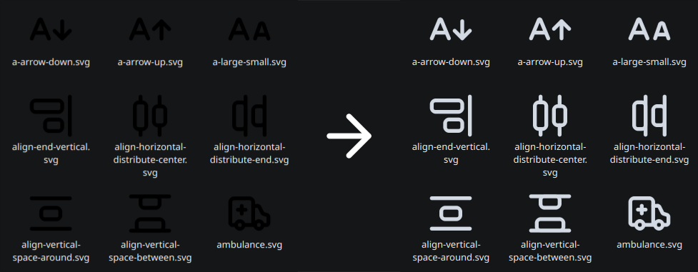

<!--
SPDX-FileCopyrightText: 2026 Leonardo Nobre <info@nobrehd.pt>
SPDX-License-Identifier: LGPL-2.0-or-later
-->
# tasvg (Theme-Aware SVG Thumbnailer for KDE Plasma 6)

`tasvg` is a KDE KIO thumbnailer plugin that dynamically resolves `currentColor` (and KDE Breeze `.ColorScheme-Text` stylesheets) in SVG files using your active desktop theme's text color. 

This prevents monochrome SVGs, UI icons (Lucide, Tabler, Feather, Breeze), and web assets from rendering as invisible black shapes in Dolphin file previews when using dark mode.

<p align="center">
  
</p>

*Preview icons shown from [Lucide](https://lucide.dev) (ISC License).*

---

## For Users (Prebuilt Packages)

Download the precompiled package for your distribution from the [Releases](https://github.com/NobreHD/kio-tasvg/releases) tab:

* **Fedora / RHEL:**
  ```bash
  sudo dnf install ./kio-tasvg-1.0.0-Linux.rpm
  ```
* **Ubuntu / Debian / KDE Neon / Kubuntu:**
  ```bash
  sudo apt install ./kio-tasvg-1.0.0-Linux.deb
  ```
* **NixOS (Flake):**
  Add `kio-tasvg` to your `flake.nix` inputs and import the NixOS module:
  ```nix
  {
    inputs.kio-tasvg.url = "github:NobreHD/kio-tasvg";

    outputs = { self, nixpkgs, kio-tasvg, ... }: {
      nixosConfigurations.my-host = nixpkgs.lib.nixosSystem {
        modules = [
          kio-tasvg.nixosModules.default
          {
            programs.kio-tasvg = {
              enable = true;
              autoSync = true; # Automatically refreshes SVG thumbnails on Day/Night switch
            };
          }
        ];
      };
    };
  }
  ```

---

## Dolphin Configuration

To make `tasvg` take effect, tell Dolphin to use it instead of the stock renderer:

1. Open **Dolphin** -> **Configure** -> **Configure Dolphin...** -> **Previews**.
2. **Uncheck** `SVG Images` *(the default renderer)*.
3. **Check** `Theme-Aware SVG (tasvg)`.
4. Click **Apply**.
5. **Clear existing SVG thumbnails** and press `F5` in Dolphin:
   ```bash
   rm -rf ~/.cache/thumbnails/*
   ```

### Optional: Automatic Light/Dark Theme Sync (`tasvg-daemon`)

By default, KDE caches generated thumbnails on disk, meaning switching between Light and Dark themes won't regenerate cached SVG previews automatically. `tasvg` includes a lightweight background user daemon (`tasvg-daemon`) that watches for theme text-color changes, purges only SVG thumbnails, and signals Dolphin to refresh them live.

Enable it via systemd:
```bash
systemctl --user enable --now tasvg-daemon.service
```

---

## For Developers (Build from Source)

### 1. Install Build Dependencies

* **Fedora:**
  ```bash
  sudo dnf install gcc-c++ cmake extra-cmake-modules kf6-kio-devel kf6-karchive-devel qt6-qtsvg-devel
  ```
* **Arch Linux:**
  ```bash
  sudo pacman -S base-devel cmake extra-cmake-modules kio karchive qt6-svg
  ```
* **Ubuntu / Debian / Neon:**
  ```bash
  sudo apt install build-essential cmake extra-cmake-modules libkf6kio-dev libkf6archive-dev libqt6svg6-dev
  ```

### 2. Compile & Install

```bash
git clone https://github.com/NobreHD/kio-tasvg.git
cd kio-tasvg

cmake -B build -S . -DCMAKE_BUILD_TYPE=Release -DCMAKE_INSTALL_PREFIX=/usr
cmake --build build
sudo cmake --install build
```
*(Pass `-DBUILD_DAEMON=OFF` to CMake if you do not want to build `tasvg-daemon`.)*

### 3. Apply Changes

Rebuild the KDE plugin cache, clear old thumbnails, and enable the sync daemon:

```bash
kbuildsycoca6
rm -rf ~/.cache/thumbnails/*
systemctl --user daemon-reload
systemctl --user enable --now tasvg-daemon.service
```
Then restart Dolphin (or press `F5` in open windows) after enabling **Theme-Aware SVG (tasvg)** in Dolphin's Preview settings.

## License
LGPL-2.0-or-later